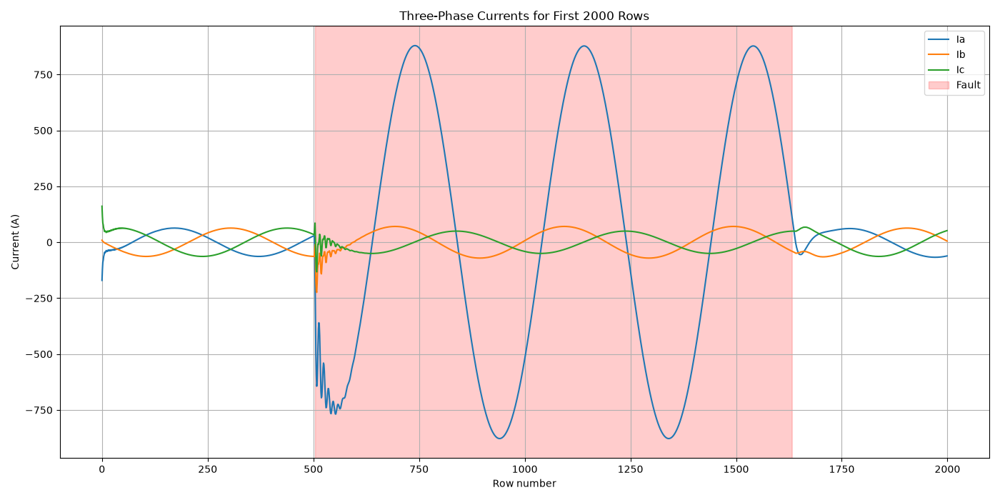
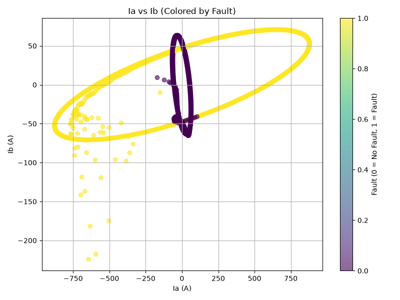
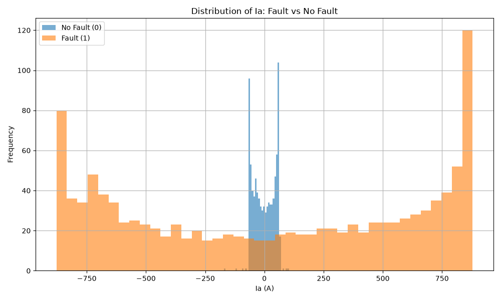
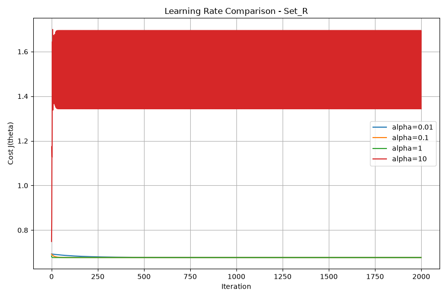
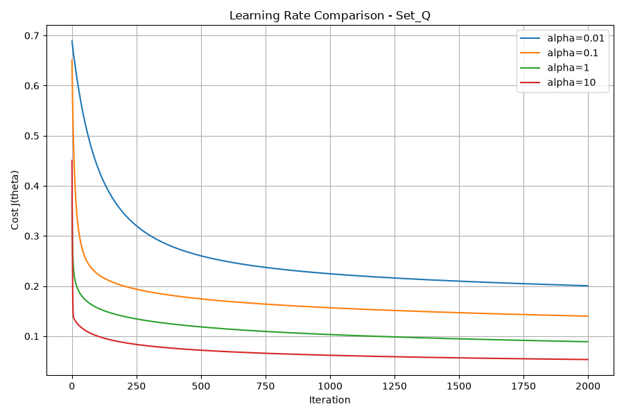

# Task 6 – Analysis

## 1. Dataset Analysis

The dataset contains electrical measurements, including three-phase currents (Ia, Ib, Ic) and voltages (Va, Vb, Vc). The target variable, `fault`, indicates whether a fault is present.

The dataset contains 12,001 rows. There are 6,505 samples in class 0 and 5,496 samples in class 1.

## 2. Exploratory Data Analysis

### Current Signals

The current signals show variations across the three phases. These variations help us examine the electrical behavior of the system and how it changes in different conditions.

### Current Relationship

The scatter plot shows the relationship between Ia and Ib for both classes. It helps visualize whether the two classes have different patterns.

### Fault Distribution

The histogram compares the Ia values for fault and non-fault samples. It helps us understand the distribution of current values in the two classes.

## 3. Logistic Regression Results

Two feature sets were evaluated:

- **Set R:** Six original current and voltage features.
- **Set Q:** The six original features and their squared terms.

The learning rate was tested using 0.01, 0.1, 1, and 10, with 2,000 iterations.

### Set R

The learning rates 0.01, 0.1, and 1 showed decreasing cost at every iteration. The learning rate 10 did not satisfy this condition because the cost increased.

The selected learning rate was 1.

- Training accuracy: 72.58%
- Validation accuracy: 73.08%
- Test accuracy: 72.64%
- Final cost: 0.677161

### Set Q

All four tested learning rates showed decreasing cost at every iteration. The selected learning rate was 10.

- Training accuracy: 97.88%
- Validation accuracy: 97.83%
- Test accuracy: 97.88%
- Final cost: 0.053435

## 4. Cost Comparison

The cost curves show how the cost changed during training for different learning rates. For Set R, a learning rate of 10 caused the cost to increase, while the other learning rates reduced it at every recorded iteration. For Set Q, all tested learning rates reduced the cost at every recorded iteration.

## 5. Comparison and Conclusion

Set Q performed better than Set R on the training, validation, and test datasets. Its test accuracy was 97.88%, compared with 72.64% for Set R.

Adding squared features allowed Set Q to represent nonlinear relationships between the input measurements and the target. The similar training, validation, and test accuracies suggest that Set Q performed consistently across these datasets.

Overall, Set Q was the better-performing feature set for this dataset.
## 6.1 Logistic Regression on Set R vs Linear SVM

Logistic Regression on Set R and the Linear SVM achieved almost the same test accuracy. Logistic Regression achieved 72.64%, while the Linear SVM achieved 73.59%.

Both models use the same six standardized current and voltage features. They learn linear decision boundaries, so their performance can be similar when the data cannot be separated easily using a linear boundary.

The results suggest that the original six features alone do not classify all fault samples effectively. Both models missed many actual faults, which is important in an electrical protection system because an undetected fault can be dangerous.
## 6.2 Interpretation of Set Q Weights

Set Q includes the six original features and their squared terms. The weights of the squared current terms (Ia², Ib², Ic²) are positive, while the weights of the squared voltage terms (Va², Vb², Vc²) are negative.

A positive weight means that increasing the corresponding squared feature tends to increase the model's predicted probability of a fault, while a negative weight tends to decrease it, assuming other features remain unchanged.

During a fault, current can increase significantly because of the additional current flowing through the fault path. This helps explain why positive weights on squared current terms can support fault detection. Voltage may drop during a fault, which can help explain the negative weights on squared voltage terms.

These interpretations should be treated as general tendencies rather than fixed rules because the model uses standardized features and combines all features when making a prediction.
## 6.3 Comparison of Support Vectors

The best Linear SVM used 5,847 support vectors, while the best RBF SVM used 274 support vectors.

The Linear SVM required many more support vectors than the RBF SVM. Support vectors are the training samples that help define the SVM decision boundary. A very large number of support vectors can indicate that many training samples are important for defining the boundary, which may increase prediction time and memory requirements.

In our results, the RBF SVM achieved much higher validation accuracy with fewer support vectors. This suggests that the RBF kernel represents the patterns in the dataset more effectively than the linear kernel.
## 6.4 Effect of C on Accuracy and Support Vectors

For the RBF SVM, increasing C generally improved validation accuracy in our experiments. The accuracy increased from 95.00% at C = 0.1 and gamma = 0.1 to 99.54% at C = 100 and gamma = 0.1. With gamma = 1, accuracy increased from 98.04% at C = 0.1 to 99.67% at C = 100.

The number of support vectors did not increase consistently. For gamma = 0.1, it decreased from 1,347 at C = 0.1 to 174 at C = 100. For gamma = 1, it decreased from 862 to 274 over the same C values.

C controls the penalty for classification errors. A larger C penalizes training errors more strongly and allows the model to fit the training data more closely. This can improve accuracy, but an excessively large C may also increase the risk of overfitting. The validation results help us compare these settings before evaluating the final model on the test set.
## 6.5 Comparison of Logistic Regression and SVM

The best Logistic Regression model was Set Q, which achieved 97.88% test accuracy. The best SVM model was the RBF SVM, which achieved 99.58% test accuracy.

The RBF SVM performed better because its nonlinear RBF kernel can represent more complex decision boundaries. Set Q also improved Logistic Regression performance by adding squared features, allowing it to model some nonlinear relationships.

The RBF SVM missed only 6 faults, compared with 45 missed faults for Logistic Regression on Set Q. Although both models performed well, the RBF SVM achieved higher accuracy and detected more actual faults on the test dataset.

For this dataset, the RBF SVM was the strongest of the four evaluated models.
## 6.6 Limitations and Future Improvements

Although the RBF SVM achieved 99.58% test accuracy, some limitations remain. It missed 6 actual fault samples and produced 4 false alarms. In an electrical protection system, missed faults are particularly important because they may create safety risks.

The current experiments use six electrical measurements and their squared terms for Set Q. Future work could explore additional features, more diverse fault conditions, and further validation on data collected under different operating conditions.

The selected RBF SVM could also be evaluated for prediction time and memory requirements before practical deployment. Additional testing on independent datasets would help determine whether the model generalizes well to real electrical systems.